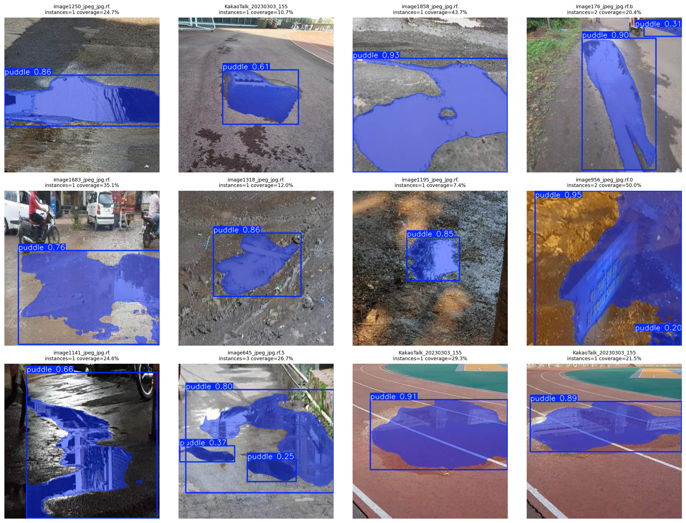
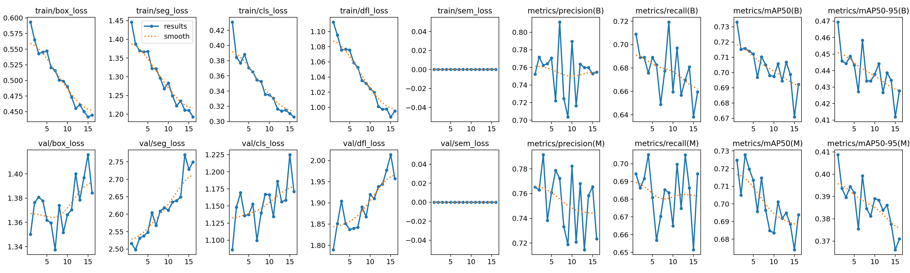
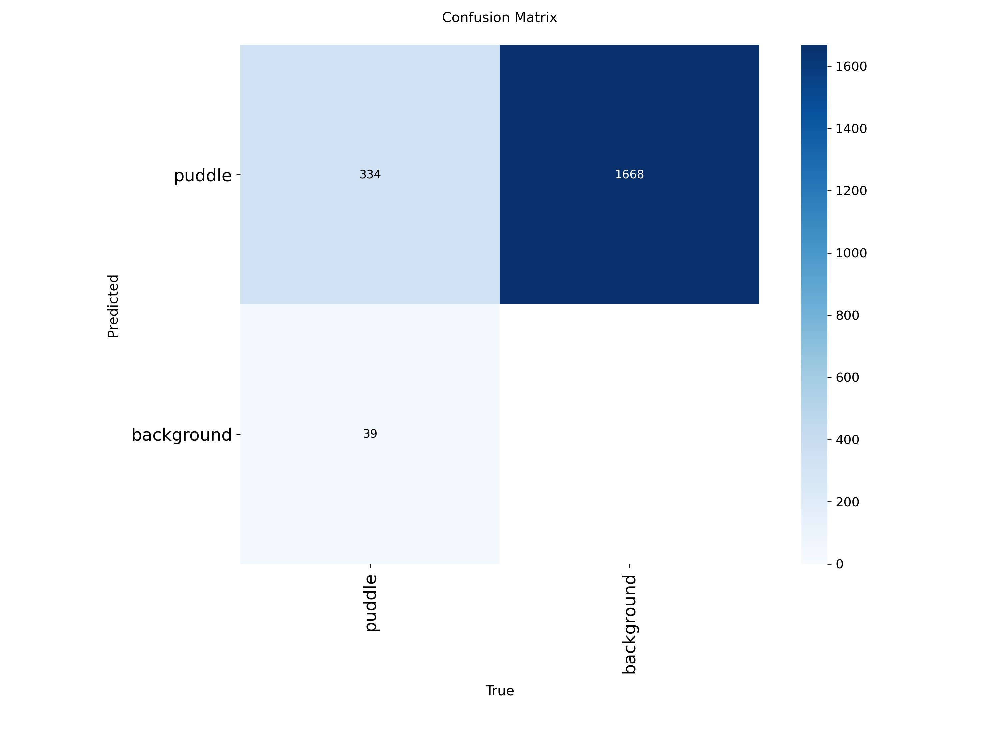

# 💧 PuddleRisk — Puddle Surface Instance Segmentation

<p align="center">
  <strong>Data-audited puddle-surface instance segmentation for road imagery</strong>
</p>

<p align="center">
  YOLO11s-seg → clean-validation evaluation → Streamlit inference
</p>

<p align="center">
  
  
  
  
  
  
</p>

---

## Overview

**PuddleRisk** is a computer-vision portfolio project for **segmenting visible puddle surfaces in road images**.

The system uses a custom-trained **YOLO11s-seg** model to produce instance masks for visible puddles, then exposes the results through a lightweight Streamlit application.

The project is intentionally scoped as a **visual segmentation MVP**.

It is not a validated puddle-depth estimator, flood-severity estimator, hydroplaning predictor, or physical road-risk scoring system.

> **Important:** reported metrics measure segmentation quality on the project's clean validation split. They must not be interpreted as physical-risk accuracy.

---

## 10% Portfolio Milestone

This repository represents the **10% learning milestone** in an ongoing portfolio growth journey.

The percentage indicates learning progress, not project count and not production-readiness.

The milestone focuses on:

- dataset auditing before training;
- semantic segmentation claims that match the labels;
- evidence-based model comparison;
- clean-validation evaluation;
- honest model limitations;
- packaging inference into a usable application.

---

## Problem

Road puddles are visually difficult because a single image may contain:

- dark asphalt;
- wet road texture;
- reflections;
- shadows;
- painted road markings;
- uneven illumination;
- irregular water boundaries;
- nearby puddles that visually merge.

A simple classification model only answers whether a puddle is present.

A bounding-box detector only approximates the region with rectangles.

PuddleRisk instead asks:

> **Where exactly is the visible puddle surface in the image?**

That makes **instance segmentation** the appropriate MVP task.

---

## Product Goal

The product goal is intentionally narrow:

```text
Road image
    ↓
Visible puddle segmentation
    ↓
Annotated image
    ↓
Puddle instance count
    ↓
Image-area mask coverage proxy
```

The MVP is useful as a visual road-surface screening component.

It is not a complete road-safety system.

---

## Scope

### In scope

PuddleRisk currently supports:

- road-image upload;
- puddle instance segmentation;
- puddle bounding-box localization;
- per-instance confidence;
- predicted puddle-instance count;
- union-mask generation;
- image-area mask coverage proxy;
- annotated prediction visualization.

### Out of scope

PuddleRisk does not currently support:

- puddle depth estimation;
- water volume estimation;
- flood severity classification;
- hydroplaning probability;
- accident probability;
- route-level risk scoring;
- geospatial risk mapping;
- road closure recommendations;
- autonomous-driving control;
- legal or safety certification.

---

## System Architecture

```text
Road image
    ↓
Image decoding / preprocessing
    ↓
YOLO11s-seg
    ↓
Bounding boxes + masks + confidence
    ↓
Post-processing
    ├── instance count
    ├── union mask
    └── coverage percentage
    ↓
Streamlit UI
    ↓
Human-readable prediction
```

---

## Inference Flow

```text
Uploaded image
    ↓
PIL image
    ↓
OpenCV BGR conversion
    ↓
YOLO11s-seg prediction
    ↓
Result object
    ├── boxes
    ├── confidences
    └── masks
    ↓
Mask union
    ↓
Coverage percentage
    ↓
Annotated output
```

---

## Model Output Semantics

The model returns three important kinds of information.

### 1. Bounding Boxes

Bounding boxes indicate the approximate rectangular region containing a predicted puddle.

They are useful for:

- localization;
- visualization;
- instance counting.

They do not represent the exact puddle shape.

---

### 2. Segmentation Masks

Segmentation masks represent the predicted visible puddle surface at pixel level.

This is the primary output of the project.

---

### 3. Confidence

Confidence represents the model's confidence in a predicted puddle instance.

Example:

```text
confidence = 0.87
```

This means the model assigned approximately 87% confidence to that prediction.

It does **not** mean:

```text
87% dangerous
87% flood risk
87% hydroplaning risk
87% severe
```

---

## Mask Coverage

The application calculates:

```text
mask_coverage =
    predicted puddle pixels
    ------------------------
    total image pixels
```

Then converts the result into a percentage.

Example:

```text
mask coverage = 18.4%
```

This means approximately 18.4% of the image area was covered by predicted puddle masks.

It does **not** measure:

- real-world puddle area;
- physical puddle volume;
- puddle depth;
- flood level;
- vehicle risk;
- road danger.

---

## Dataset

### Upstream Dataset

PuddleRisk uses the **Puddle Segmentation** dataset published by **Hanyang University** on Roboflow Universe.

**Dataset:** Puddle Segmentation  
**Publisher:** Hanyang University  
**Platform:** Roboflow Universe  
**Task:** Instance Segmentation  
**Class:** puddle  
**License:** CC BY 4.0

Official dataset page:

https://universe.roboflow.com/hanyang-university-bd2kb/puddle-segmentation

---

## Upstream Dataset Notes

The upstream Roboflow project currently reports approximately:

```text
1,500 images
1 class
6 dataset versions
Task: Instance Segmentation
License: CC BY 4.0
```

The upstream website count is useful for context.

However, the mounted export used by this project is treated as the actual experiment source of truth.

---

## Mounted Dataset Used for Training

The dataset copy used by PuddleRisk v2 contained:

| Split | Images |
|---|---:|
| Train | 1,182 |
| Provided Validation | 293 |
| Test | 0 |
| Total Mounted | 1,475 |

The mounted dataset therefore differs from the public upstream project count.

This is documented instead of silently hidden.

---

## Annotation Format

The mounted export uses YOLO-style segmentation annotations.

Positive rows contain:

```text
class_id x1 y1 x2 y2 x3 y3 ...
```

where polygon coordinates are normalized to the range:

```text
0.0 ≤ coordinate ≤ 1.0
```

The dataset contains a single class:

```text
0 = puddle
```

---

## Dataset Audit

Before training, PuddleRisk audits the mounted data.

The v2 audit found:

| Item | Value |
|---|---:|
| Train images | 1,182 |
| Provided validation images | 293 |
| Clean validation images | 291 |
| Excluded validation images | 2 |
| Test images | 0 |
| Exact cross-split duplicates | 1 |
| Empty train labels | 19 |
| Empty validation labels | 5 |

Detailed report:

```text
reports/dataset_audit_v2.json
```

---

## Why Audit the Dataset?

Model training can look successful even when the evaluation is contaminated.

Potential problems include:

- duplicate images across splits;
- malformed labels;
- mixed annotation formats;
- invalid polygons;
- missing files;
- empty labels;
- leakage between train and validation.

PuddleRisk therefore treats data validation as part of the modeling pipeline.

---

## Empty Labels

The v2 dataset contains:

```text
19 empty train labels
5 empty validation labels
```

These are retained as legitimate background / negative examples.

An empty label is not automatically treated as corrupt data.

---

## Cross-Split Duplicate

The v2 audit detected:

```text
1 exact cross-split duplicate
```

The validation-side duplicate was excluded from the clean validation set.

This prevents that image from inflating the evaluation score.

---

## Non-Polygon Validation Annotation

The original provided validation split contained one annotation row stored in bounding-box form rather than polygon segmentation form.

That sample was excluded from the clean v2 validation evaluation.

The final clean validation split contained:

```text
291 images
```

---

## Dataset License

The dataset is licensed separately from the repository source code.

### Dataset

```text
CC BY 4.0
```

Source:

https://universe.roboflow.com/hanyang-university-bd2kb/puddle-segmentation

### Repository source code

```text
MIT License
```

See:

```text
LICENSE
```

Using this repository does not change the upstream dataset license.

---

## Model Development

The project went through several experiments.

The goal was not to keep retraining until a preferred number appeared.

Each experiment tested a concrete hypothesis.

---

## v1 — Baseline

### Configuration

```text
Model       : YOLO11n-seg
Input size  : 416
Task        : instance segmentation
```

### Clean-validation results

| Metric | v1 |
|---|---:|
| Box Precision | 73.53% |
| Box Recall | 68.90% |
| Box mAP50 | 75.35% |
| Box mAP50-95 | 47.42% |
| Mask Precision | 71.90% |
| Mask Recall | 69.97% |
| Mask mAP50 | 72.56% |
| Mask mAP50-95 | 40.39% |

v1 established the baseline.

---

## What v1 Revealed

The v1 training curves showed:

- early validation instability;
- mask loss still decreasing late in training;
- improvements appearing near the end of the schedule;
- relatively weak strict-IoU mask quality.

These observations motivated the v2 experiment.

---

## v2 Stage A — Stronger Backbone

### Hypothesis

A stronger segmentation backbone and larger input resolution might improve irregular puddle-boundary modeling.

### Configuration

```text
Model       : YOLO11s-seg
Input size  : 640
Optimizer   : AdamW
Schedule    : cosine
Augmentation: conservative
```

### Stage A results

| Metric | Stage A |
|---|---:|
| Box Precision | 77.55% |
| Box Recall | 67.29% |
| Box mAP50 | 73.64% |
| Box mAP50-95 | 46.62% |
| Mask Precision | 77.62% |
| Mask Recall | 66.22% |
| Mask mAP50 | 72.39% |
| Mask mAP50-95 | 40.13% |

Stage A did not beat v1 on the primary metric.

---

## v2 Stage B — Refinement

Stage B starts from the best Stage A checkpoint.

### Changes

```text
Lower learning rate
No mosaic
Smaller geometry augmentation
Milder color augmentation
Boundary-focused refinement
```

### Champion results

| Metric | v2 Stage B |
|---|---:|
| Box Precision | 76.10% |
| Box Recall | 70.51% |
| Box mAP50 | 73.33% |
| Box mAP50-95 | 46.95% |
| Mask Precision | 76.46% |
| Mask Recall | 69.44% |
| Mask mAP50 | 72.48% |
| **Mask mAP50-95** | **40.88%** |

The Stage B checkpoint became the project champion.

---

## Champion Model

The selected model is:

```text
YOLO11s-seg
v2 Stage B
```

Repository path:

```text
models/puddlerisk_v2_champion.pt
```

The model file is checked into the repository to make local inference reproducible.

---

## Champion Selection

The primary selection metric is:

```text
Mask mAP50-95
```

The champion is not selected by:

- latest version;
- highest precision alone;
- prettiest screenshot;
- longest training;
- largest model.

---

## v1 → v2 Improvement

The v2 Stage B champion improves Mask mAP50-95 over v1 by approximately:

```text
absolute gain = +0.0049165
relative gain = +1.22%
```

The improvement is real but small.

The project documents this honestly.

---

## v3 — Data-Centric Exploratory Experiment

After v2, an additional data-centric experiment was performed.

The experiment:

- audited exact duplicates;
- searched near-duplicates using perceptual hashing;
- reviewed polygon geometry;
- removed additional suspicious validation samples;
- trained YOLO11s-seg again.

### v3 clean-validation result

| Metric | v3 |
|---|---:|
| Box Precision | 81.39% |
| Box Recall | 68.72% |
| Box mAP50 | 75.12% |
| Box mAP50-95 | 45.54% |
| Mask Precision | 80.11% |
| Mask Recall | 67.67% |
| Mask mAP50 | 73.80% |
| Mask mAP50-95 | 39.97% |

v3 improved some precision metrics.

However:

```text
Mask mAP50-95 = 39.97%
```

was below the v2 champion:

```text
Mask mAP50-95 = 40.88%
```

Therefore v3 was not promoted.

---

## Why v3 Still Matters

v3 is useful because it tested another hypothesis.

The result demonstrates:

> Better-looking precision or more aggressive cleaning does not automatically produce a better overall segmentation model.

The experiment helped identify the likely performance ceiling of the current dataset.

---

## Version Comparison

| Version | Model | Mask Precision | Mask Recall | Mask mAP50 | Mask mAP50-95 |
|---|---|---:|---:|---:|---:|
| v1 | YOLO11n-seg @ 416 | 71.90% | 69.97% | 72.56% | 40.39% |
| v2 Stage A | YOLO11s-seg @ 640 | 77.62% | 66.22% | 72.39% | 40.13% |
| **v2 Stage B** | **YOLO11s-seg @ 640** | **76.46%** | **69.44%** | **72.48%** | **40.88%** |
| v3 exploratory | YOLO11s-seg @ 640 | 80.11% | 67.67% | 73.80% | 39.97% |

---

## Main Modeling Lesson

The project demonstrates a practical ML lesson:

> Model improvement is not monotonic.

Increasing:

- model size;
- image size;
- epochs;
- cleaning aggressiveness;

does not guarantee improved generalization.

---

## Evaluation Protocol

The current evaluation uses:

```text
clean validation split
```

The current dataset does not provide:

```text
independent test split
```

Therefore the project deliberately avoids phrases such as:

```text
test accuracy
test mAP
production accuracy
real-world accuracy
```

for the current benchmark.

---

## Primary Metric

The main model-selection metric is:

```text
Mask mAP50-95
```

Why?

Because the project is primarily about segmentation quality.

Mask mAP50-95 evaluates masks across multiple IoU thresholds.

It is stricter than Mask mAP50.

---

## Secondary Metrics

The repository also records:

- Mask Precision;
- Mask Recall;
- Mask mAP50;
- Box Precision;
- Box Recall;
- Box mAP50;
- Box mAP50-95;
- inference timing.

These metrics provide additional diagnostic context.

---

## Inference Speed

The v2 Stage B clean-validation report measured approximately:

```text
preprocess   ≈ 1.46 ms/image
inference    ≈ 13.91 ms/image
postprocess  ≈ 1.79 ms/image
```

These values were measured in the training/evaluation environment.

They should not be treated as universal device latency.

---

## Visual Evaluation

Metrics are not the only evidence.

PuddleRisk also stores qualitative predictions to inspect:

- missed puddles;
- false positives;
- merged masks;
- fragmented masks;
- reflections;
- shadows;
- low-contrast regions.

---

## Prediction Grid

<p align="center">
  
</p>

---

## Stage B Training Curves

<p align="center">
  
</p>

---

## Stage B Confusion Matrix

<p align="center">
  
</p>

---

## Additional Evaluation Assets

The `assets/` directory also contains:

```text
Box F1 curves
Box precision curves
Box recall curves
Box PR curves
Mask F1 curves
Mask precision curves
Mask recall curves
Mask PR curves
normalized confusion matrices
training result plots
```

These files make the portfolio result auditable.

---

## Streamlit Application

The local Streamlit app supports:

- image upload;
- configurable confidence threshold;
- configurable IoU threshold;
- model inference;
- side-by-side original/prediction preview;
- puddle-instance count;
- predicted mask coverage;
- mean confidence;
- per-instance confidence display;
- no-detection handling.

---

## Application Output

Example UI metrics:

```text
Detected Puddle Instances
Predicted Mask Coverage
Mean Detection Confidence
```

These values have distinct meanings.

Do not merge them into one artificial risk score.

---

## Default Inference Settings

| Parameter | Value |
|---|---:|
| Image size | 640 |
| Confidence | 0.25 |
| IoU | 0.60 |
| Retina masks | True |

These are application defaults.

They are not guaranteed optimal for every environment.

---

## Core Source Modules

### `src/model.py`

Responsibilities:

- locate the checkpoint;
- verify the checkpoint exists;
- load the YOLO model.

Default checkpoint:

```text
models/puddlerisk_v2_champion.pt
```

---

### `src/inference.py`

Responsibilities:

- run model inference;
- read segmentation masks;
- read confidence values;
- count predicted instances;
- combine masks;
- calculate coverage;
- return structured prediction results.

---

### `src/utils.py`

Responsibilities:

- PIL → OpenCV conversion;
- BGR → RGB conversion;
- confidence formatting.

---

### `app/app.py`

Responsibilities:

- Streamlit layout;
- upload control;
- inference sliders;
- model result display;
- user-facing explanations.

The UI intentionally does not own core model logic.

---

## Repository Structure

```text
puddlerisk-segmentation/
├── app/
│   └── app.py
│
├── assets/
│   ├── stage_a_clean_val_BoxF1_curve.png
│   ├── stage_a_clean_val_BoxPR_curve.png
│   ├── stage_a_clean_val_BoxP_curve.png
│   ├── stage_a_clean_val_BoxR_curve.png
│   ├── stage_a_clean_val_MaskF1_curve.png
│   ├── stage_a_clean_val_MaskPR_curve.png
│   ├── stage_a_clean_val_MaskP_curve.png
│   ├── stage_a_clean_val_MaskR_curve.png
│   ├── stage_a_clean_val_confusion_matrix.png
│   ├── stage_b_clean_val_*.png
│   ├── stage_b_refine_*.png
│   └── v2_prediction_grid.png
│
├── models/
│   └── puddlerisk_v2_champion.pt
│
├── reports/
│   ├── dataset_audit_v2.json
│   ├── final_summary_v2.json
│   ├── stage_a_metrics.json
│   ├── stage_b_metrics.json
│   ├── tta_diagnostic.json
│   ├── v1_v2_comparison.csv
│   └── v2_prediction_preview.csv
│
├── src/
│   ├── __init__.py
│   ├── inference.py
│   ├── model.py
│   └── utils.py
│
├── .gitignore
├── AGENTS.md
├── LICENSE
├── README.md
└── requirements.txt
```

---

## Files Not Stored in Git

Training-only or temporary artifacts are intentionally excluded.

Examples:

```text
dataset/
dataset_local/
runs/
__pycache__/
*.cache
```

Reasons include:

- repository size;
- reproducibility cleanliness;
- dataset licensing;
- generated-file noise;
- unnecessary duplication.

---

## Running Locally

Clone the repository:

```bash
git clone https://github.com/MENSTRUE/puddlerisk-segmentation.git
cd puddlerisk-segmentation
```

---

## Windows Setup

Create virtual environment:

```powershell
python -m venv .venv
```

Activate:

```powershell
.\.venv\Scripts\Activate.ps1
```

Install dependencies:

```powershell
pip install -r requirements.txt
```

Run application:

```powershell
streamlit run app/app.py
```

---

## Linux / macOS Setup

```bash
python -m venv .venv
source .venv/bin/activate
pip install -r requirements.txt
streamlit run app/app.py
```

---

## Runtime Dependencies

Current runtime stack:

- Python;
- PyTorch;
- Ultralytics;
- OpenCV;
- NumPy;
- Pillow;
- Streamlit.

See:

```text
requirements.txt
```

---

## Model Loading

The runtime expects:

```text
models/puddlerisk_v2_champion.pt
```

If the file is missing, inference should fail clearly.

The app should not silently replace it with a different pretrained model.

---

## Reproducibility

The repository preserves:

- champion checkpoint;
- evaluation JSON;
- comparison CSV;
- dataset audit;
- qualitative predictions;
- evaluation curves;
- inference source code;
- runtime dependencies.

This makes the project auditable instead of showing only a final number.

---

## Training Workflow

The project training workflow can be summarized as:

```text
Dataset
    ↓
Audit
    ↓
Annotation validation
    ↓
Clean validation split
    ↓
Baseline
    ↓
Improvement hypothesis
    ↓
Training
    ↓
Validation
    ↓
Qualitative inspection
    ↓
Version comparison
    ↓
Champion selection
    ↓
Inference packaging
```

---

## Key Design Decision: Why Segmentation?

Puddles rarely have neat rectangular geometry.

A bounding box may include large amounts of:

- asphalt;
- sidewalk;
- road markings;
- surrounding background.

Segmentation better represents the visible water boundary.

---

## Key Design Decision: Why YOLO11s-seg?

The project initially used YOLO11n-seg.

The stronger YOLO11s-seg model was explored because puddle boundaries can be irregular and subtle.

However, the project did not assume the larger model would automatically win.

The v2 experiment explicitly measured whether it improved the primary metric.

---

## Key Design Decision: Why 640 px?

v1 used 416 px.

v2 used 640 px to give the segmentation head more spatial resolution for irregular boundaries.

This does not create new image detail.

It only changes how the model processes the available image.

---

## Key Design Decision: Why Stage B Refinement?

Stage A alone did not beat v1 on Mask mAP50-95.

Rather than discarding the experiment immediately, Stage B tested whether low-learning-rate refinement with reduced augmentation could better adapt the segmentation boundary.

The hypothesis produced a small improvement.

---

## Key Design Decision: Why Keep v2 Instead of v3?

v3 is newer.

But its primary metric was lower.

Therefore:

```text
v2 remains champion
```

The project deliberately separates:

```text
latest experiment
```

from:

```text
best validated model
```

---

## Known Failure Modes

Potential failure cases include:

### Reflections

Bright reflected sky or buildings may resemble water.

### Shadows

Dark shadow boundaries may resemble wet asphalt.

### Dark Asphalt

Low-contrast puddles may blend into the road.

### Small Puddles

Small regions may be missed.

### Connected Water Regions

Nearby puddles may merge into one mask.

### Fragmentation

One real puddle may occasionally be predicted as multiple mask fragments.

### Domain Shift

Images from unseen cameras, weather, cities, or lighting conditions may behave differently from the validation data.

---

## Limitations

1. **No independent test split**  
   Current official project evaluation is based on clean validation.

2. **Small dataset**  
   The mounted training set contains 1,182 training images.

3. **Single class**  
   The model only predicts `puddle`.

4. **No physical labels**  
   The dataset does not contain puddle depth, water volume, or road-risk labels.

5. **Dataset-specific benchmark**  
   Current metrics do not establish universal real-world performance.

6. **Image-only inference**  
   The current application does not use temporal video information.

7. **No geospatial context**  
   Predictions are image-space outputs only.

8. **No safety certification**  
   The system is not validated for safety-critical use.

---

## Responsible Use

PuddleRisk should not be used as the sole basis for:

- autonomous vehicle control;
- road closure decisions;
- emergency response;
- flood-depth estimation;
- legal decisions;
- insurance decisions;
- safety certification.

A production road-inspection system would require:

- larger representative datasets;
- independent test data;
- geographic diversity;
- calibration;
- monitoring;
- reliability testing;
- operational safeguards;
- domain-expert validation.

---

## Product Interpretation Guide

### Correct

> The model segmented a visible puddle region.

### Incorrect

> The road is 80% dangerous.

---

### Correct

> The predicted masks cover 14% of the image.

### Incorrect

> The puddle is 14% deep.

---

### Correct

> The model confidence for this instance is 0.91.

### Incorrect

> The puddle has a 91% accident probability.

---

## Reports

### Dataset audit

```text
reports/dataset_audit_v2.json
```

Contains:

- mounted split counts;
- clean validation count;
- duplicate findings;
- empty-label counts.

---

### Stage A metrics

```text
reports/stage_a_metrics.json
```

Contains:

- box metrics;
- mask metrics;
- validation timing;
- checkpoint metadata.

---

### Stage B metrics

```text
reports/stage_b_metrics.json
```

Contains champion clean-validation results.

---

### Version comparison

```text
reports/v1_v2_comparison.csv
```

Contains experiment-level metric comparison.

---

### TTA diagnostic

```text
reports/tta_diagnostic.json
```

Stores the test-time augmentation diagnostic result.

---

### Prediction preview

```text
reports/v2_prediction_preview.csv
```

Stores a qualitative prediction sample summary.

---

### Final scientific summary

```text
reports/final_summary_v2.json
```

This is the main machine-readable summary for the selected champion.

---

## Before

PuddleRisk began as a simple road-puddle portfolio concept.

Early goals were broad:

```text
detect puddles
estimate possible risk
build a usable app
```

During development, the scope was narrowed.

The dataset only directly supports visual puddle masks.

Therefore the project was reframed from vague "risk detection" toward:

```text
puddle surface instance segmentation
```

This reduced unsupported claims and made the evaluation meaningful.

---

## Now

The current repository includes:

- audited dataset summary;
- clean-validation benchmark;
- v1 baseline;
- v2 model experiments;
- selected champion checkpoint;
- failed-improvement evidence;
- prediction assets;
- Streamlit inference UI;
- reusable source modules;
- documented limitations;
- machine-readable reports;
- repository governance rules.

---

## Next

Future work should prioritize meaningful evidence.

### Data improvements

- collect more road scenes;
- add different cities;
- add different camera viewpoints;
- add night scenes;
- add rain scenes;
- add low-light scenes;
- add hard negatives;
- manually review difficult masks;
- create an independent test split.

---

### Model improvements

Potential research directions:

- compare lightweight segmentation architectures;
- test better mask resolution;
- evaluate calibration;
- benchmark confidence thresholds;
- test augmentation strategies only with explicit hypotheses;
- test stronger encoders only when dataset scale justifies them.

---

### Inference improvements

Possible extensions:

- batch-image inference;
- video inference;
- temporal smoothing;
- downloadable annotated results;
- JSON prediction export;
- REST API;
- ONNX export;
- edge inference.

---

### Product improvements

Possible product features:

- prediction history;
- failure-case gallery;
- batch report generation;
- model diagnostics panel;
- threshold presets;
- deployment health information.

---

## Future Risk Modeling

The project name contains the word `Risk`.

However, the current model does not output a physical risk score.

A future risk module would require direct labels such as:

- measured puddle depth;
- water level;
- road geometry;
- surface friction;
- vehicle speed;
- rainfall;
- accident outcome;
- hydroplaning event.

Only then would a physically meaningful risk model become defensible.

---

## Evaluation Roadmap

A stronger future evaluation setup should include:

```text
Training split
Validation split
Independent test split
External-domain test set
```

Potential external-domain categories:

- daytime;
- nighttime;
- dry surroundings;
- heavy reflections;
- rainy scenes;
- urban roads;
- residential roads;
- different cameras.

---

## Deployment Roadmap

Potential deployment path:

```text
PyTorch checkpoint
    ↓
ONNX export
    ↓
runtime benchmark
    ↓
CPU/GPU comparison
    ↓
edge-device benchmark
    ↓
application integration
```

No deployment format should be added only for appearance.

It should be tied to a real runtime requirement.

---

## Reliability Roadmap

Future reliability work may include:

- confidence calibration;
- uncertainty inspection;
- failure-case logging;
- threshold analysis;
- dataset drift monitoring;
- output sanity checks;
- model version tracking.

---

## Testing Roadmap

Future codebase improvements:

```text
tests/
├── test_model_loading.py
├── test_image_conversion.py
├── test_no_detection.py
├── test_mask_coverage.py
└── test_inference_contract.py
```

Important tests include:

- missing model file;
- invalid image;
- zero detections;
- one detection;
- multiple detections;
- coverage = 0;
- coverage ≤ 100;
- model output shape consistency.

---

## Security and Privacy

The current local application processes uploaded images locally in the Streamlit runtime.

Future hosted versions should explicitly document:

- image retention;
- logging;
- telemetry;
- user data handling;
- external storage.

No hidden telemetry should be introduced without documentation.

---

## Contribution Philosophy

Contributions should improve at least one of:

- correctness;
- reproducibility;
- robustness;
- clarity;
- usability;
- evaluation quality.

Changes that only make claims sound more impressive are not improvements.

---

## Development Rules

See:

```text
AGENTS.md
```

for detailed rules covering:

- agent behavior;
- model promotion;
- metrics;
- dataset scope;
- claims;
- Git policy;
- testing;
- future development.

---

## Git Workflow

Recommended commit style:

```text
feat: add puddle segmentation inference pipeline
fix: handle no-mask predictions
docs: document dataset and evaluation protocol
refactor: separate model loading from UI
test: add inference edge-case coverage
chore: update dependencies
```

Avoid:

```text
update
changes
fix stuff
day 10
commit
```

---

## Example Local Workflow

```powershell
git pull origin main

python -m venv .venv
.\.venv\Scripts\Activate.ps1

pip install -r requirements.txt

streamlit run app/app.py
```

After changes:

```powershell
git status
git add .
git commit -m "feat: describe actual change"
git push origin main
```

---

## Troubleshooting

### Model not found

Expected file:

```text
models/puddlerisk_v2_champion.pt
```

Confirm:

```powershell
Get-Item .\models\puddlerisk_v2_champion.pt
```

---

### Streamlit command not found

Install requirements:

```powershell
pip install -r requirements.txt
```

Then:

```powershell
python -m streamlit run app/app.py
```

---

### OpenCV import issue

The repository uses:

```text
opencv-python-headless
```

This is intentional for Streamlit/server environments.

---

### CUDA not available

The application can run on CPU.

GPU is not required for local demonstration, although inference speed may be slower.

---

### No puddle detected

Try lowering the confidence threshold carefully.

A lower threshold can increase detections but may also increase false positives.

Do not interpret threshold manipulation as model improvement.

---

## FAQ

### Is PuddleRisk a flood detector?

No.

It segments puddle surfaces in still images.

---

### Does it estimate depth?

No.

There are no physical depth labels in the current dataset.

---

### Does mask coverage mean severity?

No.

Mask coverage is an image-space ratio only.

---

### Why is the metric not 90%?

Segmentation mAP50-95 is a strict localization metric.

It should not be compared directly to classification accuracy.

The project reports the real benchmark rather than inventing a friendlier metric.

---

### Why keep a model with only a small improvement?

Because it is the best measured checkpoint under the current protocol.

The project prefers evidence over cosmetic versioning.

---

### Why not use v3?

Because v3 did not beat v2 Stage B on the primary metric.

---

### Why no test metric?

The mounted dataset does not provide an independent test split.

Calling validation performance "test performance" would be misleading.

---

### Can this be used for autonomous driving?

No.

Not in its current form.

---

### Can the model be exported to ONNX?

Potentially yes.

That is future deployment work and should be benchmarked before being added as a supported target.

---

## Reproducibility Checklist

A reproducible PuddleRisk result should preserve:

- dataset source;
- dataset version/export details;
- split definitions;
- data audit;
- model architecture;
- input resolution;
- optimizer;
- training schedule;
- augmentation;
- primary metric;
- checkpoint;
- evaluation outputs.

---

## Portfolio Evidence Checklist

This repository includes evidence beyond a final number:

```text
[x] Model checkpoint
[x] Dataset audit
[x] Metrics JSON
[x] Version comparison CSV
[x] Training curves
[x] Confusion matrix
[x] Prediction grid
[x] Inference application
[x] Limitations
[x] Future roadmap
```

---

## Scope Statement

PuddleRisk should be described as:

> **A YOLO11s-seg-based puddle-surface instance-segmentation MVP trained on a public puddle dataset and evaluated on a cleaned validation split.**

It may also be described as:

> **A visual road-surface observation component for localizing visible puddle regions.**

It should not be described as:

- a validated road-risk predictor;
- a puddle-depth model;
- a flood severity model;
- a hydroplaning predictor;
- a production road-safety system.

---

## Tech Stack

- Python
- PyTorch
- Ultralytics YOLO11
- OpenCV
- NumPy
- Pillow
- Streamlit
- Kaggle
- Git
- GitHub

---

## Dataset Citation

Dataset page:

https://universe.roboflow.com/hanyang-university-bd2kb/puddle-segmentation

Upstream publisher:

```text
Hanyang University
```

Platform:

```text
Roboflow Universe
```

License:

```text
CC BY 4.0
```

Users of the dataset should follow the attribution requirements on the upstream dataset page.

---

## License

This repository source code is released under the:

[MIT License](LICENSE)

The dataset is not relicensed by this repository.

---

## Author

**Wafa Bila Syaefurokhman**

GitHub:

[@MENSTRUE](https://github.com/MENSTRUE)

Repository:

https://github.com/MENSTRUE/puddlerisk-segmentation

---

## Project Principle

<p align="center">
  <strong>Audit → train → measure → compare → document → improve.</strong>
</p>

<p align="center">
  Build the smallest useful system that can be defended by the data.
</p>
